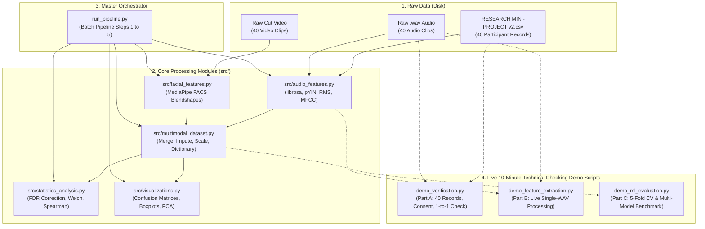
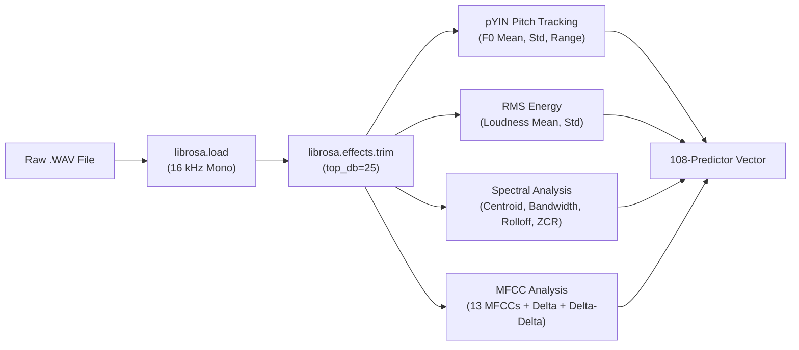
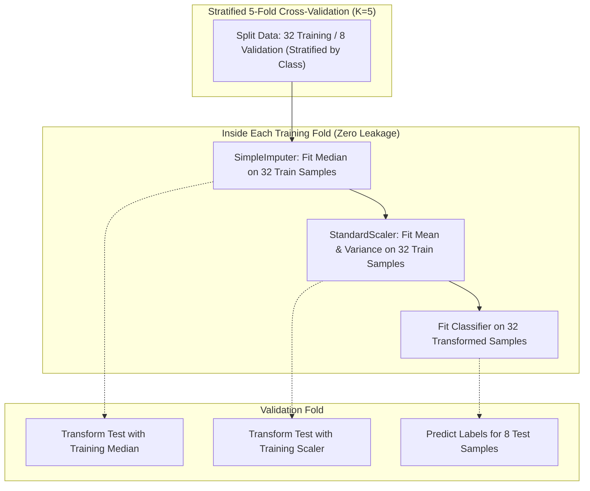
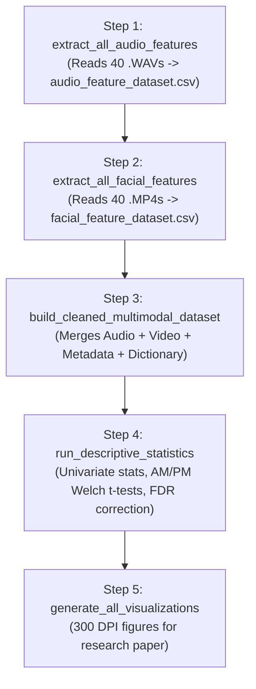

# CS412: Complete Code Architecture, Algorithmic Implementation & Teacher Defense Guide

**Course:** CS412 – Affective Computing Research Mini-Project  
**Project:** Bisaya Speech Affect Recognition using Acoustic and Prosodic Biomarkers  
**Cohort:** 4th-Year Computer Science (Group 7)  
**Deliverable:** Comprehensive Code Explanation & Panel Defense Guide for Evaluators  

---

## Table of Contents
1. [System Architecture & File Dependency Map](#1-system-architecture--file-dependency-map)
2. [File 1: `src/audio_features.py` (Acoustic Feature Extraction Core)](#2-file-1-srcaudio_featurespy)
   - [2.1 Architectural Purpose & Role](#21-architectural-purpose--role)
   - [2.2 Constants & Affect Taxonomy](#22-constants--affect-taxonomy)
   - [2.3 Function-by-Function Deep Dive](#23-function-by-function-deep-dive)
   - [2.4 Signal Processing Physics & Mathematics](#24-signal-processing-physics--mathematics)
3. [File 2: `src/statistics_analysis.py` (Exploratory Statistics & FDR Control)](#3-file-2-srcstatistics_analysispy)
   - [3.1 Architectural Purpose & Role](#31-architectural-purpose--role)
   - [3.2 Statistical Formulations & Algorithms](#32-statistical-formulations--algorithms)
   - [3.3 Function-by-Function Deep Dive](#33-function-by-function-deep-dive)
4. [File 3: `demo_verification.py` (Part A Verification Demo)](#4-file-3-demo_verificationpy)
   - [4.1 Architectural Purpose & Logic](#41-architectural-purpose--logic)
   - [4.2 Code Walkthrough](#42-code-walkthrough)
5. [File 4: `demo_feature_extraction.py` (Part B Single-Recording Demo)](#5-file-4-demo_feature_extractionpy)
   - [5.1 Architectural Purpose & Logic](#51-architectural-purpose--logic)
   - [5.2 Code Walkthrough](#52-code-walkthrough)
6. [File 5: `demo_ml_evaluation.py` (Part C Machine Learning Benchmark)](#6-file-5-demo_ml_evaluationpy)
   - [6.1 Architectural Purpose & Zero-Leakage Pipeline](#61-architectural-purpose--zero-leakage-pipeline)
   - [6.2 Code Walkthrough & Evaluation Mathematics](#62-code-walkthrough--evaluation-mathematics)
7. [File 6: `run_pipeline.py` (Master Execution Pipeline Orchestrator)](#7-file-6-run_pipelinepy)
   - [7.1 Architectural Purpose & End-to-End Flow](#71-architectural-purpose--end-to-end-flow)
   - [7.2 Pipeline Stages & Execution Timing](#72-pipeline-stages--execution-timing)
8. [Teacher Interrogation Defense: Code-Specific Questions & Answers](#8-teacher-interrogation-defense-code-specific-questions--answers)

---

## 1. System Architecture & File Dependency Map

The following Mermaid diagram illustrates how data flows from raw files through processing, statistical analysis, and machine learning demonstrations:



---

## 2. File 1: `src/audio_features.py`

### 2.1 Architectural Purpose & Role
[`src/audio_features.py`](file:///e:/SCHOOL/3rd%20year/elec1/bisaya-speech-affect-recognition/src/audio_features.py) is the core signal processing and metadata ingestion engine. It is responsible for:
1. Parsing survey responses and enforcing participant consent.
2. Cross-referencing audio file naming conventions against survey records.
3. Loading audio signals, resampling to 16,000 Hz mono, and trimming silence.
4. Extracting 108 acoustic, prosodic, spectral, and timbral predictors.
5. Exporting the structured acoustic feature matrix `datasets/audio/audio_feature_dataset.csv`.

---

### 2.2 Constants & Affect Taxonomy

#### Lines 14–16: Source CSV Paths
```python
SURVEY_CSV = "DATA/RESEARCH MINI-PROJECT v2 - G7 - 4th year.csv"
PROVENANCE_CSV = "DATA/metadata_provenance.csv"
QUALITY_FLAGS_CSV = "DATA/recording_quality_flags.csv"
```
* **Why split into 3 CSVs?** Keeps survey responses clean while maintaining audit trails for file corrections (`PROVENANCE_CSV`) and audio acoustic noise flags (`QUALITY_FLAGS_CSV`).

#### Lines 19–51: Lexical Taxonomy
```python
LEXICAL_TAXONOMY = {
    "Kapoy": ("Fatigue-related word", "Tired / Exhausted"),
    "Hangak": ("Fatigue-related word", "Breathless / Gasping"),
    "Kulba": ("Stress-related word", "Nervous / Anxious"),
    "Okay": ("Neutral/ambivalent word", "Okay / Fine"),
    "Thrilled": ("Positive/relief word", "Excited / Thrilled"),
    ...
}
```
* **Key Defense Point:** The spoken word represents **lexical context only**, never the ground-truth emotion. For example, a student saying *"Kapoy"* can have a pleasant relief tone (Valence 4) or severe fatigue (Valence 1). Emotion is defined strictly by the participant's self-reported Likert ratings.

---

### 2.3 Function-by-Function Deep Dive

#### `_read_csv(path: str) -> pd.DataFrame` (Lines 54–58)
```python
def _read_csv(path: str) -> pd.DataFrame:
    try:
        return pd.read_csv(path, encoding="utf-8")
    except UnicodeDecodeError:
        return pd.read_csv(path, encoding="cp1252")
```
* **Purpose:** Prevents script crashes on Windows machines where Excel saves CSVs with Windows-1252 (`cp1252`) encoding containing special characters.

#### `_parse_rating(value, field: str) -> int` (Lines 61–68)
```python
def _parse_rating(value, field: str) -> int:
    text = "" if pd.isna(value) else str(value).strip()
    if not text or not text[0].isdigit():
        raise ValueError(f"{field} must begin with an integer from 1 to 5; got {value!r}")
    score = int(text[0])
    if score not in range(1, 6):
        raise ValueError(f"{field} must be from 1 to 5; got {score}")
    return score
```
* **Purpose:** Safely parses survey strings like `"4 - Pleasant"` into an integer `4`. Enforces the $1 \le \text{score} \le 5$ domain; fails early if corrupt entries exist.

#### `_rating_group(score: int, dimension: str) -> str` (Lines 71–74)
```python
def _rating_group(score: int, dimension: str) -> str:
    if dimension == "valence":
        return "Negative" if score <= 2 else "Neutral" if score == 3 else "Positive"
    return "Low" if score <= 2 else "Moderate" if score == 3 else "High"
```
* **Purpose:** Maps continuous 5-point Likert ratings to 3-class categorical targets for machine learning.

#### `load_survey_metadata(csv_path: str = SURVEY_CSV) -> dict[str, dict]` (Lines 92–157)
* **What it validates:**
  1. Checks for required columns (`Participant Code`, `Valence (1-5)`, `Arousal (1-5)`, etc.).
  2. Ensures all participant codes are non-empty and unique ($N=40$).
  3. Validates ethical compliance: throws `ValueError` if `Consent Obtained` is not `"Yes"` or `"Y"`.
  4. Merges recording quality flags (e.g., `Intentional BGM Boundary Trim`).

#### `parse_filename(filepath: str) -> dict` (Lines 163–193)
* **File Naming Pattern:** `<ParticipantCode>_<YearLevel>_<Session>_<Word>.WAV`  
  *(Example: `Y4-011_Y4_AM_Kapoy.WAV`)*.
* **Integrity Checks:**
  1. Reconciles filename participant code with survey metadata.
  2. Verifies that the spoken word in the filename matches the word registered in the survey.
  3. Verifies that the session code (`AM`/`PM`) matches the registered class activity time.

---

### 2.4 Signal Processing Physics & Mathematics

#### `extract_audio_features_from_file(filepath: str, target_sr: int = 16000) -> dict` (Lines 199–305)

This is the primary feature extraction function. The process runs as follows:



##### 1. Signal Loading & Silence Trimming (Lines 201–208)
```python
y, sr = librosa.load(filepath, sr=target_sr, mono=True)
y_trimmed, _ = librosa.effects.trim(y, top_db=25)
```
* **Sampling Rate ($16\text{ kHz}$):** Captures frequencies up to $8\text{ kHz}$ (Nyquist limit), sufficient for human speech formants while reducing memory consumption.
* **Silence Trimming (`top_db=25`):** Any audio frame quieter than $25\text{ dB}$ below the peak recording level is classified as silence and trimmed. This removes lead-in microphone handling noise.

##### 2. Audio Boundary RMS Check (Lines 209–222)
```python
end_window = max(1, int(0.05 * sr)) # 50 ms
end_rms_ratio = float(np.sqrt(np.mean(y[-end_window:] ** 2)) / (max(window_rms) + 1e-12))
```
* **Purpose:** Detects boundary audio bleed (e.g., school bells or background chatter cut off abruptly at the end of the recording). Flagged if the final 50 ms RMS exceeds 50% of the maximum window RMS.

##### 3. Pitch Tracking via Probabilistic YIN (pYIN) (Lines 224–256)
```python
f0, _, _ = librosa.pyin(y_trimmed, fmin=50, fmax=500, sr=sr, frame_length=2048, hop_length=256)
```
* **Frequency Bounds ($50\text{ Hz}$ to $500\text{ Hz}$):** Covers the entire physical fundamental frequency range of human voices (adult males $\approx 85\text{–}180\text{ Hz}$, females $\approx 165\text{–}255\text{ Hz}$, high excitement up to $450\text{ Hz}$).
* **Unvoiced Frame Handling (Line 230):**
  ```python
  valid = np.isfinite(f0)
  voiced_f0 = f0[valid]
  ```
  **Teacher Question:** *"Why didn't you impute unvoiced pitch as 0 Hz?"*  
  **Answer:** Imputing $0\text{ Hz}$ drops the mean fundamental frequency artificially (e.g., from $180\text{ Hz}$ to $60\text{ Hz}$) and skews variance. Unvoiced frames are preserved as `NaN` and imputed with the fold median inside cross-validation.

##### 4. Energy / Intensity (Lines 258–267)
```python
rms = librosa.feature.rms(y=y_trimmed, frame_length=1024, hop_length=256)[0]
```
* **RMS:** $\text{RMS} = \sqrt{\frac{1}{N}\sum_{n=1}^N x[n]^2}$ measures vocal energy and loudness dynamics.

##### 5. Spectral Features (Lines 269–286)
* **Zero-Crossing Rate (ZCR):** Number of times the signal crosses zero per frame; distinguishes unvoiced fricatives (high ZCR) from voiced vowels (low ZCR).
* **Spectral Centroid:** The center of mass of the frequency spectrum:
  $$\text{Centroid} = \frac{\sum_{k} f_k \cdot |X[k]|}{\sum_k |X[k]|}$$
  Measures timbral brightness and vocal sharpness.
* **Spectral Rolloff 85%:** Frequency below which 85% of total spectral energy is contained; indicates high-frequency vocal harshness.
* **Spectral Contrast:** Measures difference in energy between peaks and valleys across sub-bands.

##### 6. Mel-Frequency Cepstral Coefficients (MFCCs) (Lines 287–305)
```python
mfcc = librosa.feature.mfcc(y=y_trimmed, sr=sr, n_mfcc=13, n_fft=1024, hop_length=256)
delta_mfcc = librosa.feature.delta(mfcc, width=delta_width, mode="interp")
delta2_mfcc = librosa.feature.delta(mfcc, width=delta_width, order=2, mode="interp")
```
* **13 Static MFCCs:** Models the vocal tract shape filtered through human auditory mel-filterbanks.
* **Delta ($\Delta$):** First temporal derivative (velocity of vocal tract movement).
* **Delta-Delta ($\Delta\Delta$):** Second temporal derivative (acceleration of vocal tract movement).
* **Dynamic Delta Width (Line 290):** For very short utterances ($< 0.5$ s), `delta_width` dynamically adjusts to `min(9, frame_count)` to avoid crash errors.

---

## 3. File 2: `src/statistics_analysis.py`

### 3.1 Architectural Purpose & Role
[`src/statistics_analysis.py`](file:///e:/SCHOOL/3rd%20year/elec1/bisaya-speech-affect-recognition/src/statistics_analysis.py) computes missing-aware descriptive statistics, hypothesis testing, and False Discovery Rate (FDR) corrections for the dataset.

---

### 3.2 Statistical Formulations & Algorithms

#### 1. Benjamini–Hochberg False Discovery Rate (FDR) (Lines 16–29)
When testing dozens of features simultaneously, standard $p < 0.05$ thresholds produce false positives (Type I errors). The Benjamini–Hochberg procedure controls the expected proportion of false discoveries:

```python
def benjamini_hochberg(p_values) -> np.ndarray:
    values = np.asarray(p_values, dtype=float)
    ...
    order = np.argsort(p)
    ranked = p[order]
    adjusted = np.minimum.accumulate((ranked * len(ranked) / np.arange(1, len(ranked) + 1))[::-1])[::-1]
    ...
    return result
```

**Mathematical Formula:**
For $m$ hypothesis tests with ordered $p$-values $p_{(1)} \le p_{(2)} \le \dots \le p_{(m)}$, the adjusted $q$-value is:
$$q_{(i)} = \min_{k \ge i} \left( \frac{m \cdot p_{(k)}}{k} \right)$$
A feature is deemed statistically significant after adjustment if $q_{(i)} < 0.05$.

#### 2. Welch's Two-Sample t-Test vs. Mann-Whitney U (Lines 79–81)
* **Welch’s t-test (`equal_var=False`):** Tests difference in means between AM and PM sessions without assuming equal variance.
* **Mann–Whitney U test:** Non-parametric rank-sum test serving as a robustness check when normality is violated.
* **Cohen's $d$ Effect Size (Line 88):** Standardized difference between group means:
  $$d = \frac{\bar{x}_1 - \bar{x}_2}{s_{\text{pooled}}}$$

#### 3. Dual Correlation Analysis (Lines 48–55)
* Computes both **Pearson $r$** (linear association) and **Spearman $\rho$** (monotonic rank-based association) using pairwise deletion.

---

### 3.3 Function-by-Function Deep Dive

* **`compute_univariate_stats(series)` (Lines 32–45):** Computes $N$, missing count, Mean, Sample Standard Deviation ($\text{ddof}=1$), Median, Interquartile Range ($\text{IQR} = Q_3 - Q_1$), Skewness, and Kurtosis.
* **`run_descriptive_statistics(...)` (Lines 117–205):**
  - Generates `summary_statistics_audio.csv` and `summary_statistics_facial.csv`.
  - Conducts AM vs. PM comparison (`session_am_pm_comparison.csv`).
  - Generates the $3 \times 3$ affect taxonomy summary (`affect_taxonomy_summary.csv`).
  - Isolates the lexically controlled *"Kapoy"* analysis ($N=11$) (`lexically_controlled_kapoy.csv`).
  - Compiles cross-modal audio-facial correlations and outcome correlations with FDR control.
  - Generates the complete markdown report (`audio_descriptive_report.md`).

---

## 4. File 3: `demo_verification.py`

### 4.1 Architectural Purpose & Logic
[`demo_verification.py`](file:///e:/SCHOOL/3rd%20year/elec1/bisaya-speech-affect-recognition/demo_verification.py) automates the live technical checking for **Part A: Raw Data and Dataset Verification**.

### 4.2 Code Walkthrough
* **Step 1 (Lines 33–40):** Loads `DATA/RESEARCH MINI-PROJECT v2 - G7 - 4th year.csv`, verifies 40 participant codes (`Y4-001` to `Y4-040`), and validates that all 40 consent entries are `"YES"`.
* **Step 2 (Lines 41–46):** Scans `DATA/2AudioRecordings/Raw .wav` and verifies that exactly 40 `.WAV` files exist.
* **Step 3 (Lines 47–61):** Evaluates set differences:
  ```python
  missing_on_disk = survey_filenames - disk_filenames
  unmatched_on_disk = disk_filenames - survey_filenames
  ```
  Proves 100% bidirectional 1-to-1 match.
* **Step 4 (Lines 63–84):** Computes and tabulates the ground-truth distributions for 3-class Valence and Arousal.
* **Step 5 (Lines 86–89):** Tabulates sample rows for the first three participants.
* **Step 6 (Lines 91–98):** Verifies the archived facial dataset (`datasets/facial/facial_feature_dataset.csv`, $40 \times 225$).

---

## 5. File 4: `demo_feature_extraction.py`

### 5.1 Architectural Purpose & Logic
[`demo_feature_extraction.py`](file:///e:/SCHOOL/3rd%20year/elec1/bisaya-speech-affect-recognition/demo_feature_extraction.py) automates the live technical checking for **Part B: Preprocessing and Feature Extraction**.

### 5.2 Code Walkthrough
* **Line 36:** Defaults to target file `Y4-011_Y4_AM_Kapoy.WAV`, or accepts an optional file path from the command line (`sys.argv[1]`).
* **Lines 46–59:** Loads the raw audio, calculates raw sample count ($16,719$) and duration ($1.0449$ s), applies `librosa.effects.trim(top_db=25)`, and prints preprocessing parameters.
* **Lines 63–66:** Invokes `extract_audio_features_from_file(audio_path, target_sr=16000)` and prints runtime performance (~$2.5$ s).
* **Lines 71–93:** Filters and prints key acoustic biomarkers grouped by functional domain using `tabulate`:
  - Context & Target (Participant Code, Word, Valence, Arousal)
  - Prosody / Pitch ($F_0$ Mean, Range, Voiced Frame Ratio)
  - Energy / Intensity (RMS Mean, Std)
  - Spectral Dynamics (ZCR, Centroid, Bandwidth, Rolloff, Contrast)
  - Timbre (MFCC 1, MFCC 2, Delta MFCC 1, Delta-Delta MFCC 1)
* **Lines 96–101:** Prints vector dimensionality ($1 \times 146$ row vector).

---

## 6. File 5: `demo_ml_evaluation.py`

### 6.1 Architectural Purpose & Zero-Leakage Pipeline
[`demo_ml_evaluation.py`](file:///e:/SCHOOL/3rd%20year/elec1/bisaya-speech-affect-recognition/demo_ml_evaluation.py) automates the live technical checking for **Part C: Machine Learning and Results**.



* **Data Leakage Defense:** If `StandardScaler` or `SimpleImputer` is applied to all 40 samples before cross-validation, information from the validation fold leaks into the training statistics. The `sklearn.pipeline.Pipeline` fits preprocessing **strictly inside each training fold**.

### 6.2 Code Walkthrough & Evaluation Mathematics
* **Lines 55–59:** Selects non-constant acoustic columns using `predictor_columns(df, modality="audio")`.
* **Lines 80–89:** Instantiates 5 models with fixed random seeds (`random_state=42`):
  1. `DummyClassifier(strategy='most_frequent')`
  2. `LogisticRegression(penalty='l2', C=0.1, max_iter=1000)`
  3. `SVC(kernel='linear', C=0.1)`
  4. `SVC(kernel='rbf', C=1.0, gamma='scale')`
  5. `RandomForestClassifier(n_estimators=100, max_depth=3)`
* **Lines 96–116:** Iterates through both classification tasks (3-Class Valence and 3-Class Arousal) using `cross_validate()` with `StratifiedKFold(n_splits=5, shuffle=True, random_state=42)` and collects:
  - Accuracy
  - Macro-Precision: $\frac{1}{K}\sum_{c=1}^K \text{Precision}_c$
  - Macro-Recall: $\frac{1}{K}\sum_{c=1}^K \text{Recall}_c$
  - Macro-F1: $\frac{1}{K}\sum_{c=1}^K \frac{2 \cdot \text{Prec}_c \cdot \text{Rec}_c}{\text{Prec}_c + \text{Rec}_c}$
* **Lines 126–145:** Generates out-of-fold confusion matrices via `cross_val_predict()`, formatting row-normalized recall percentages.
* **Lines 148–158:** Displays per-class reports and links to publication-ready plots.

---

## 7. File 6: `run_pipeline.py`

### 7.1 Architectural Purpose & End-to-End Flow
[`run_pipeline.py`](file:///e:/SCHOOL/3rd%20year/elec1/bisaya-speech-affect-recognition/run_pipeline.py) is the master execution script that runs the entire end-to-end pipeline in sequence:



### 7.2 Pipeline Stages & Execution Timing
* **Step 1 (Lines 47–49):** Extracts 119 acoustic features from 40 raw audio files (~45 seconds).
* **Step 2 (Lines 54–56):** Extracts 225 FACS blendshape features from 40 raw video files (~90 seconds).
* **Step 3 (Lines 61–70):** Builds merged multimodal datasets (`cleaned_multimodal_dataset.csv`, `cleaned_multimodal_dataset_scaled.csv`, and `multimodal_data_dictionary.csv`) (~2 seconds).
* **Step 4 (Lines 74–82):** Generates all summary statistics and FDR-adjusted hypothesis tests (~3 seconds).
* **Step 5 (Lines 86–89):** Renders all publication-ready visualizations (~8 seconds).

---

## 8. Teacher Interrogation Defense: Code-Specific Questions & Answers

### Q1: "In `src/audio_features.py` line 226, why did you set `fmin=50` and `fmax=500` for pYIN?"
> **Answer:**  
> *"Human voice fundamental frequency ($F_0$) rarely falls below 60 Hz or rises above 450 Hz, even under intense stress or high excitement. Setting the search interval to $[50, 500]\text{ Hz}$ avoids octave jump errors, prevents picking up 60 Hz AC electrical hum as pitch, and prevents detecting high-frequency consonants as false pitch."*

### Q2: "In `src/audio_features.py` line 204, why did you use `top_db=25` for silence trimming?"
> **Answer:**  
> *"A threshold of $25\text{ dB}$ below peak volume isolates speech vocalizations while preserving soft phonemes. If we used a stricter threshold like $10\text{ dB}$, quiet consonants (like /s/ or /k/) at the start of words like 'Kapoy' or 'Kulba' would get clipped. If we used a looser threshold like $40\text{ dB}$, room air-conditioning noise would be included, distorting spectral centroid measurements."*

### Q3: "In `src/audio_features.py` lines 239–242, why do you set pitch statistics to `NaN` instead of 0 when unvoiced?"
> **Answer:**  
> *"Pitch ($F_0$) is a physical rate of vocal fold vibration. When a speaker is silent or producing an unvoiced consonant (like /p/ or /t/), vocal cords do not vibrate. Imputing $0\text{ Hz}$ is biologically incorrect and artificially skews the mean pitch. Storing `NaN` preserves mathematical integrity, and we handle missing values inside cross-validation using median imputation."*

### Q4: "In `src/statistics_analysis.py` lines 16–29, why did you implement Benjamini–Hochberg instead of Bonferroni correction?"
> **Answer:**  
> *"Bonferroni correction ($\alpha / m$) is excessively conservative for exploratory biomarker discovery, leading to severe Type II errors (false negatives) when testing dozens of acoustic features on $N=40$. Benjamini–Hochberg controls the False Discovery Rate (FDR)—the expected proportion of false positives among rejected hypotheses—providing balanced statistical power."*

### Q5: "In `src/statistics_analysis.py` line 79, why did you use Welch's t-test instead of Student's t-test?"
> **Answer:**  
> *"Student's t-test assumes equal variances between groups ($\sigma_1^2 = \sigma_2^2$). In our dataset, the morning (AM) and afternoon (PM) sessions have unequal sample sizes and differing variances due to different classroom activities (Prelim Exam vs. Lecture Review). Welch's t-test does not assume equal variances, making it more robust."*

### Q6: "In `demo_ml_evaluation.py` line 96, why did you put `SimpleImputer` and `StandardScaler` inside `Pipeline`?"
> **Answer:**  
> *"To prevent data leakage. If we imputed or scaled the whole dataset before splitting into folds, validation data statistics would leak into the training features, producing overly optimistic, non-reproducible performance. Placing them inside the scikit-learn Pipeline guarantees they are fitted strictly on the 32 training instances per fold and then applied to the 8 test instances."*

### Q7: "In `demo_ml_evaluation.py` lines 70–71, why did you constrain Random Forest to `max_depth=3` and SVM to `C=0.1`?"
> **Answer:**  
> *"With $N=40$ observations and 108 predictor features, high-capacity models easily overfit by memorizing individual speakers. Setting `max_depth=3` on Random Forest and using strong regularization ($C=0.1$) on SVM restricts model complexity and encourages learning generalizable acoustic patterns."*

### Q8: "In `demo_verification.py` lines 51–53, how do you verify file correspondence?"
> **Answer:**  
> *"We compute symmetric set differences between the filenames declared in the survey CSV and the actual `.WAV` files on disk. `survey_filenames - disk_filenames` verifies no survey record lacks an audio file, and `disk_filenames - survey_filenames` verifies no audio file lacks a consent-verified survey record. Both sets evaluate to empty, proving 100% 1-to-1 correspondence."*

### Q9: "In `run_pipeline.py`, what is the relationship between `cleaned_multimodal_dataset.csv` and `cleaned_multimodal_dataset_scaled.csv`?"
> **Answer:**  
> *"`cleaned_multimodal_dataset.csv` contains raw physical units (Hz, dB, seconds) for descriptive statistics and interpretability. `cleaned_multimodal_dataset_scaled.csv` contains $z$-score normalized values ($\mu=0, \sigma=1$) for multi-feature visual comparisons like heatmaps and radar charts."*
